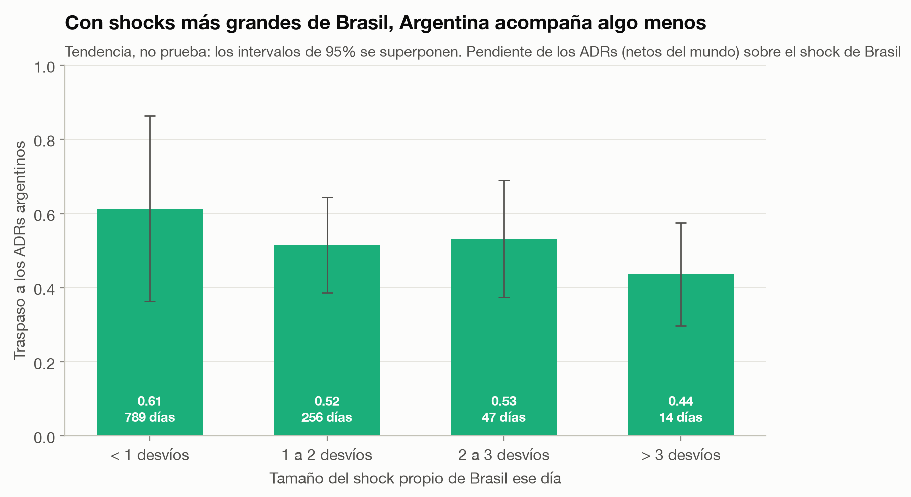
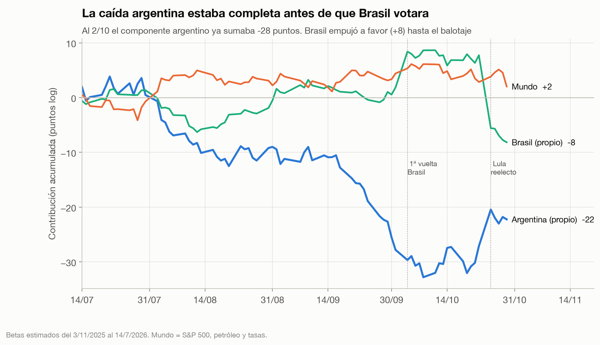
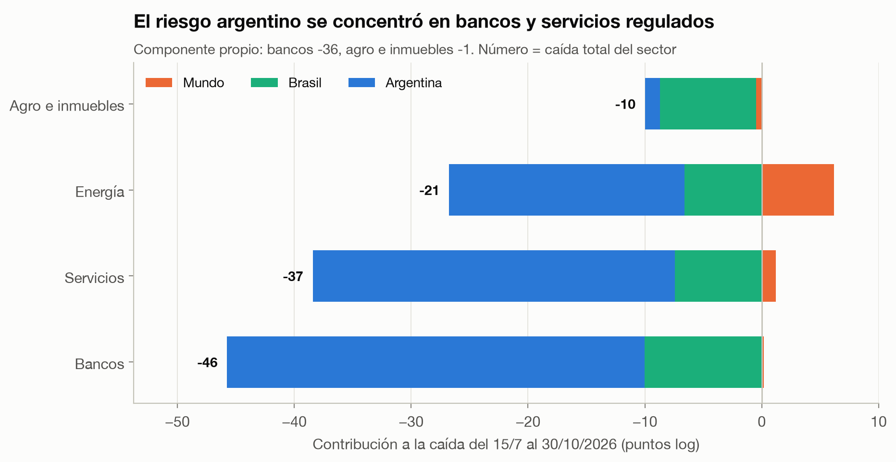
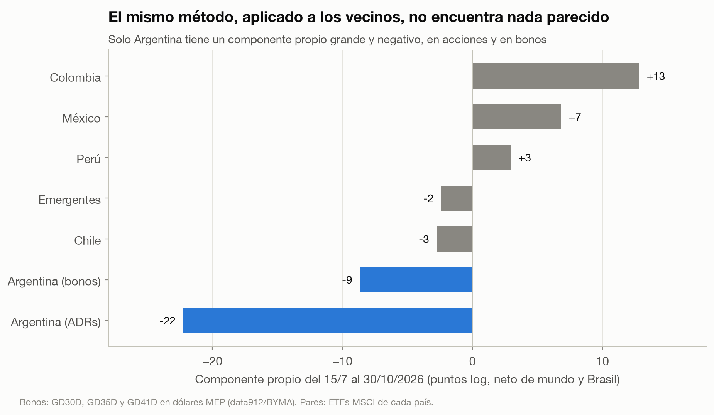

# ¿Argentina, Brasil o el mundo?

**Qué explica la caída de los activos argentinos en 2026: un *event study* del gobierno de Milei y del contagio de la reelección de Lula.**


## Resumen

- **El contexto.** Desde el mínimo del riesgo país a mediados de julio de 2026, los ADRs argentinos cayeron **25% en dólares**, mientras el S&P 500 quedó plano. El riesgo país superó los 700 puntos en octubre y siguió subiendo tras la reelección de Lula en Brasil (25/10). El gobierno atribuyó la suba al contexto internacional y a la incertidumbre electoral.
- **La respuesta: 4 de cada 5 puntos de la caída son argentinos.** Con un modelo de factores estimado *antes* de la caída, el mundo (acciones, petróleo, tasas) explica **+2 puntos**, es decir, empujó a favor. Brasil explica **−8**. Quedan **−22 puntos** (78%) que ni Brasil ni el mundo explican. Con cuatro ventanas de estimación distintas, la parte argentina va del 77% al 96%. Con toda la incertidumbre de estimación incluida, el intervalo de 95% va de −33 a −12, y la probabilidad de que sea menos de la mitad de la caída es 5%.
- **En los bonos, el riesgo país, es todavía más claro.** Los Globales en dólares cayeron 11 puntos: 8,7 son argentinos y apenas 1,2 vienen de Brasil. Su beta a Brasil es 0,09, casi nulo. El día de Lula, los bonos cayeron 2,2%, una variación que no es significativa. El mismo método aplicado a México, Chile, Perú, Colombia y emergentes no encuentra en ninguno un componente propio negativo de esa magnitud.
- **La caída argentina ya había ocurrido cuando Brasil votó.** Al 2/10, antes de la primera vuelta brasileña, el componente argentino ya sumaba −28 puntos. Hasta el balotaje, Brasil había *sumado* 8 puntos a favor. Todo el aporte negativo de Brasil se concentra en la semana de Lula. Además, la caída argentina fue un goteo: ninguno de los 77 días bajó más de 2 desvíos.
- **El castigo fue a bancos y servicios regulados.** El componente argentino restó 36 puntos a los bancos y 31 a los servicios (EDN, TEO). En energía restó 20. En agro e inmuebles, apenas 1.
- **Lo que mueve a la Argentina es la política argentina.** En dos días, la derrota en Buenos Aires (sep. 2025) restó 20% a los ADRs, el respaldo del Tesoro de EEUU sumó 14% y el triunfo en las legislativas, 31%. La reelección de Lula, el shock regional más grande de la muestra, restó **8%**. Los tres efectos significativos siguen siéndolo sin suponer normalidad.
- **Los shocks políticos de Brasil llegan amortiguados.** El 26/10 cayeron más los ADRs más expuestos a Brasil (correlación −0,68, p = 0,01). Aun así, los argentinos cayeron solo el **38%** de lo que predecía su beta, contra 88% de las acciones brasileñas. En los 10 días de mayor shock propio de Brasil desde 2022, casi todos ligados a Lula, el traspaso promedió 0,4, contra 0,6 en un día normal. Es una tendencia, pero no es estadísticamente significativa.

## 1. Preguntas e hipótesis

1. **¿Qué parte de la caída desde julio de 2026 es Argentina, Brasil o el mundo?** H0: los factores externos explican la mayor parte. Se rechaza si el componente propio de Argentina supera la mitad de la caída en todas las ventanas de estimación.
2. **¿Los eventos políticos argentinos mueven más a los ADRs que los brasileños?** Se mide con retornos anormales y su estadístico t.
3. **¿El contagio de Lula pasó por la exposición a Brasil?** H0: no hay relación entre la sensibilidad previa a Brasil y la caída del 26/10. Se rechaza si la correlación entre ambas es negativa y significativa.
4. **¿Fue especial el 26/10?** H0: en los días grandes de Brasil, Argentina reacciona con el mismo beta que en un día normal. Si no, el bajo traspaso de Lula no es una lectura del mercado sobre *ese* shock sino una regularidad.
5. **¿El resultado es un artefacto del método?** Se aplica el mismo procedimiento, con los mismos betas y fechas, a los bonos soberanos y a cinco mercados de comparación. Si todos dieran un componente propio grande y negativo, el método lo estaría fabricando.

## 2. Datos

| | |
|---|---|
| Argentina | Canasta equiponderada de 13 ADRs: GGAL, BMA, BBAR, SUPV, YPF, PAM, TGS, CEPU, EDN, TEO, CRESY, LOMA, IRS |
| Brasil | EWZ (ETF MSCI Brasil); ITUB, NU, PBR para el corte transversal |
| Mundo | S&P 500 (SPY), petróleo Brent (BZ=F), tasa del Tesoro de EEUU a 10 años (^TNX) |
| Aparte | Mercado Libre (MELI): es argentina pero con más negocio en Brasil |
| Bonos | Globales GD30D, GD35D y GD41D (corto, medio y largo), precio en dólares MEP en BYMA, vía [data912](https://data912.com) |
| Comparación | ETFs MSCI de México (EWW), Chile (ECH), Perú (EPU), Colombia (COLO) y emergentes (EEM) |
| Fuente | Yahoo Finance (precios ajustados) y data912, congelados a CSV en `data/` |
| Período | junio 2022 a 30/10/2026, ruedas de Wall Street |

Por qué ADRs: cotizan en dólares en un mercado líquido, así que miden lo que ve un inversor internacional, sin la distorsión del tipo de cambio local. Por qué EWZ y no el Ibovespa: cotiza en las mismas ruedas y la misma moneda que los ADRs.

## 3. Método

**Retorno anormal (eventos).** Para cada evento se estima un modelo de factores con 250 ruedas que terminan 10 ruedas antes del evento, para que encuestas y rumores no contaminen lo que se considera "normal". El retorno anormal es lo que pasó menos lo que el modelo predecía dada la jornada del S&P 500, el petróleo y las tasas. Se acumula en el día 0 y el +1, y el estadístico t sale de la volatilidad de los residuos (Brown & Warner, 1985). Como los ADRs argentinos tienen colas gordas, se suma un **p empírico** que no supone normalidad: la fracción de ventanas de dos días de la ventana de estimación con un residuo al menos igual de grande.

**Factor Brasil.** Es el retorno de EWZ que no explican los factores globales: el shock *propio* de Brasil. Sin esa limpieza, una caída global se contaría dos veces.

**Atribución de la caída.** Los betas de los ADRs a los cuatro factores se estiman del 3/11/2025 (después de las legislativas) al 14/7/2026, **fuera** del período a explicar. Cada factor aporta su beta por el retorno que tuvo entre el 15/7 y el 30/10. Lo que queda es el componente argentino. Estimar los betas dentro del mismo período haría que el residuo diera cero por construcción.

**Incertidumbre de la atribución.** El total es observado, así que el componente argentino solo es incierto porque los betas lo son. Se mide de dos maneras:

- **Analítica:** √(s′ Σ s), con s los retornos acumulados de los factores y Σ la covarianza de los betas. Trata al factor Brasil como un dato.
- **Bootstrap en dos etapas:** en cada una de 5.000 réplicas se re-muestrean los días de la ventana de estimación, en bloques de 10 para respetar la agrupación de la volatilidad. Después se re-estiman las dos regresiones: EWZ sobre el mundo, que da el factor Brasil, y los ADRs sobre todo.

La diferencia entre las dos importa. El factor Brasil descuenta el intercepto de EWZ estimado en la ventana, y ese descuento se repite los 77 días de la caída: un error chico en el intercepto se multiplica por 77. Solo el bootstrap lo captura. Aparte, se compara con la historia: ¿con qué frecuencia el residuo de 77 ruedas fue igual o peor desde 2023?

**Robustez y placebo.** La atribución se repite agregando un factor emergente (EEM) o uno de LatAm sin Brasil. También se repite día a día (cuándo se acumuló cada parte), por sector, para los bonos y, como placebo, para cinco mercados de comparación.

**Bonos.** Los Globales pagan cupón y amortización el 9 de enero y el 9 de julio, y el precio cae en la fecha ex sin que cambie el riesgo. Se excluyen los retornos del 5 al 12 de esos meses. Ninguna de esas fechas cae dentro de la caída. Los días de feriado argentino con Wall Street abierto, el bono arrastra su último precio.

**Días grandes de Brasil.** Regresión de los ADRs sobre los factores, el shock de Brasil y su interacción con un indicador de día grande (|shock| > 2, 2,5 y 3 desvíos), sin el 26 y 27/10. Además, la pendiente se estima por tramos de tamaño del shock.

**Catálogo de eventos.** Solo hechos con fecha cierta, cada uno con su fuente ([`estudio/eventos.py`](estudio/eventos.py)). Las elecciones de domingo tienen el día 0 el lunes. Los procesos graduales, como la suba del riesgo país o la guerra en el Golfo, entran como factores y no como eventos.

## 4. Resultados

### Los eventos


| Evento | ADRs argentinos | t | p emp | Bonos argentinos | t | p emp | Brasil (EWZ) | t | p emp |
|---|---:|---:|---:|---:|---:|---:|---:|---:|---:|
| Asume Milei (11/12/23) | +2,7% | 0,7 | 0,46 | +0,3% | 0,1 | 0,92 | −1,6% | −0,7 | 0,40 |
| Devaluación (13/12/23) | −3,9% | −1,0 | 0,31 | +2,9% | 0,7 | 0,37 | +2,2% | 1,0 | 0,27 |
| Paquete fiscal Haddad (27/11/24) | +0,0% | 0,0 | 1,00 | −0,3% | −0,1 | 0,86 | **−8,1%** | −5,0 | <0,004 |
| Aranceles de Trump (3/4/25) | +5,4% | 1,5 | 0,13 | +1,6% | 0,8 | 0,39 | +1,1% | 0,6 | 0,49 |
| Salida del cepo (14/4/25) | +6,3% | 1,8 | 0,08 | **+7,2%** | 3,6 | 0,004 | −0,5% | −0,3 | 0,77 |
| Derrota en Buenos Aires (8/9/25) | **−20,5%** | −5,7 | <0,004 | **−6,7%** | −4,5 | 0,008 | −0,7% | −0,4 | 0,68 |
| Respaldo del Tesoro de EEUU (22/9/25) | **+13,6%** | 3,8 | 0,004 | **+19,9%** | 12,9 | <0,004 | +1,1% | 0,6 | 0,55 |
| Triunfo en legislativas (27/10/25) | **+31,4%** | 7,1 | <0,004 | **+16,8%** | 6,1 | 0,004 | +0,8% | 0,4 | 0,67 |
| 1ª vuelta en Brasil: Flávio adelante (5/10/26) | +4,7% | 1,1 | 0,19 | +2,2% | 0,7 | 0,12 | **+10,6%** | 5,3 | <0,004 |
| Lula reelecto (26/10/26) | **−8,3%** | −2,0 | 0,016 | −2,2% | −1,1 | 0,08 | **−23,1%** | −10,3 | <0,004 |

En negrita, significativo al 5%. "p emp" no supone normalidad; con 249 ventanas de comparación, el mínimo que puede resolver es 0,004. Ningún evento cambia de clasificación: lo significativo con el t sigue siéndolo sin él. La salida del cepo queda en el borde para las acciones (p emp 0,08).

**Los bonos cuentan la historia con más nitidez.** Reaccionaron a cuatro de los seis hechos argentinos (cepo, Buenos Aires, Tesoro y legislativas) y a ninguno de los brasileños. El shock más grande para los bonos no fue electoral: fue el respaldo del Tesoro de EEUU (+20%, t = 12,9), un evento sobre el financiamiento. Las acciones, en cambio, reaccionaron más a las elecciones (+31% con las legislativas). Tiene lógica: al bonista le importa si el país paga; al accionista, además, el rumbo de la economía. Los shocks argentinos no movieron a Brasil, y los brasileños movieron a la Argentina mucho menos que a Brasil: el traspaso fue de alrededor de 0,4 (4,7/10,6 y 8,3/23,1). La reelección de Lula fue, en dos días, el peor shock propio de Brasil de la muestra.

### La reelección de Lula, acción por acción


Entre los ADRs argentinos, la correlación entre la sensibilidad previa a Brasil y la caída del 26/10 es **−0,68** (p = 0,011, n = 13): el contagio pasó por la exposición a Brasil. Los bancos (SUPV, BBAR) cayeron más; la energía (YPF, PAM) menos, porque su negocio depende de Vaca Muerta y del petróleo, no de Brasil.

El dato más interesante es la magnitud:

| Grupo | Caída predicha por su beta a Brasil | Caída real | Traspaso |
|---|---:|---:|---:|
| ADRs argentinos | −15,0 | −5,7 | **0,38** |
| Acciones brasileñas | −21,4 | −18,8 | 0,88 |
| Mercado Libre | −7,6 | −8,1 | 1,07 |

Puntos log, promedio por grupo, 26/10/2026. Un ADR argentino promedio cayó menos de 4 de cada 10 puntos que predecía su comovimiento habitual con Brasil. Las acciones brasileñas cayeron casi todo lo predicho. Mercado Libre, con la mayor parte de su negocio en Brasil, cayó todo.

### ¿Fue especial Lula? Probablemente no, aunque la evidencia es débil

| Día | Shock propio de Brasil | ADRs argentinos (netos del mundo) | Traspaso |
|---|---:|---:|---:|
| 3/10/2022 (1ª vuelta Lula-Bolsonaro) | +6,3% | +2,0% | 0,32 |
| 24/10/2022 | −7,5% | −2,4% | 0,31 |
| 31/10/2022 (Lula gana) | +4,7% | +2,1% | 0,45 |
| 7/11/2022 | −5,3% | −3,7% | 0,69 |
| 10/11/2022 (discurso fiscal de Lula) | −13,1% | −7,6% | 0,58 |
| 3/1/2023 (asume Lula) | −7,9% | −1,3% | 0,16 |
| 11/4/2023 | +5,2% | +2,6% | 0,51 |
| 5/12/2025 | −6,6% | −2,2% | 0,34 |
| 5/10/2026 (1ª vuelta, Flávio adelante) | +11,2% | +5,1% | 0,46 |
| 26/10/2026 (Lula reelecto) | −22,8% | −6,4% | 0,28 |

Los diez días de mayor shock propio de Brasil desde 2022. Ocho de ellos caen alrededor de las elecciones brasileñas de 2022 y 2026 o de la transición a Lula. El traspaso promedio de esos diez días es 0,41; el de un día normal, 0,59.



| Umbral de "día grande" | Días grandes | Beta en día normal | Diferencia en días grandes | t |
|---|---:|---:|---:|---:|
| 2 desvíos | 61 | 0,58 | −0,07 | −0,7 |
| 2,5 desvíos | 30 | 0,59 | −0,12 | −1,2 |
| 3 desvíos | 14 | 0,58 | −0,11 | −1,0 |

La dirección es la misma con los tres umbrales y con los tramos de la figura: el traspaso baja de 0,61 a 0,44 a medida que crece el shock. Ninguna diferencia es significativa.

La lectura posible: el comovimiento de todos los días refleja el humor hacia la región, mientras que los grandes shocks políticos brasileños se leen como brasileños. Lula 2026 está en el extremo bajo del rango (0,28), junto a su asunción de 2023 (0,16). Los datos son *consistentes* con que el 26/10 no fue especial. No alcanzan para *probarlo*.

### Una relación que se estrechó y se aflojó


La sensibilidad de los ADRs al shock propio de Brasil se duplicó: de 0,41 en promedio en 2025 a 0,80 en septiembre de 2026, en plena campaña brasileña. Con la caída de octubre, que fue sobre todo argentina, volvió a 0,44. No es inédito: antes de la elección argentina de 2023 también llegó a 1,0. **En años electorales, Argentina y Brasil se mueven más juntos.**

### ¿Quién tiró abajo a los ADRs desde julio?


| Ventana de estimación de betas | Mundo | Brasil | Argentina | Total |
|---|---:|---:|---:|---:|
| **3/11/2025 a 14/7/2026 (base)** | +2,0 | −8,2 | **−22,2** | −28,4 |
| 2/1/2024 a 14/7/2026 | +2,5 | −3,6 | −27,3 | −28,4 |
| 15/7/2025 a 14/7/2026 | +3,7 | −7,6 | −24,4 | −28,4 |
| 2/1/2026 a 14/7/2026 | +2,2 | −8,6 | −21,9 | −28,4 |

Puntos de retorno logarítmico; "Mundo" suma S&P 500, petróleo y tasas. Detalle por factor en [`estudio/results.md`](estudio/results.md).

En ninguna ventana el contexto global explica la caída: el S&P 500 subió y los ADRs argentinos casi no reaccionan al petróleo (beta 0,03), aun con un Brent que subió más de 35% en el período. Brasil restó entre 4 y 9 puntos. El resto, **entre 22 y 27 puntos de 28**, es argentino.

**¿Qué tan seguro es el reparto?** Depende de qué incertidumbre se cuente:

| Intervalo de 95% del componente argentino (ADRs) | Desde | Mediana | Hasta | P(menos de la mitad) |
|---|---:|---:|---:|---:|
| Solo betas, factor Brasil como dato | −26,8 | −22,2 | −17,7 | ≈ 0 |
| Bootstrap en dos etapas (también re-estima el factor Brasil) | −33,3 | −23,8 | −12,0 | 5,4% |

La segunda fila es la honesta. Casi toda la diferencia viene del factor Brasil: su contribución tiene un intervalo de −19 a +4. Como se explicó en el Método, el intercepto de EWZ se arrastra los 77 días. El componente argentino sigue siendo la mayor parte con 95% de probabilidad, pero el "78%" es una estimación central con un margen amplio, no un número preciso. En los bonos, el mismo bootstrap da un intervalo estrecho: −10,6 a −6,8, con 0,3% de probabilidad de ser menos de la mitad.

**¿Cambia con otros factores?** No. Si se agrega un factor emergente (EEM), el componente argentino queda en −21,8. Si se agrega uno de LatAm sin Brasil, sube a −25,3, porque parte de lo que antes se cargaba a Brasil pasa a la región.

**¿Fue un shock o un goteo?** Un goteo. El peor día argentino de la caída fue −3,4% (4/8). Ninguno de los 77 días superó los 2 desvíos (4,1%), y el 57% de los días fueron negativos. Los 10 peores días suman −27, los 10 mejores +28. Es lo opuesto a 2025, cuando la derrota en Buenos Aires restó 20% en dos días. Un deterioro gradual encaja mejor con un cambio de expectativas macro (inflación, actividad, encuestas) que con un hecho puntual.

**¿Qué tan raro es?** Menos de lo que parece. Los ADRs argentinos tienen mucho ruido propio: 2% diario de residuo, unos 18 puntos en 77 ruedas. Desde 2023, el 5,6% de las ventanas de 77 ruedas tuvo un componente argentino igual o peor. El peor fue −65 puntos, en la previa de las legislativas de 2025. La caída de 2026 es claramente argentina, pero no es una crisis inédita: es un tercio de la de 2025.

### Cuándo se acumuló cada parte



El componente argentino bajó en dos tramos: −10 en agosto y −18 entre mediados de septiembre y el 2/10. Al 2/10, **antes de que Brasil votara, ya sumaba −28 puntos**. Hasta el 23/10, la víspera del balotaje, Brasil había *sumado* 8 puntos, con el rally del triunfo parcial de Flávio Bolsonaro. Toda la contribución negativa de Brasil, unos −16 puntos, llega con la semana de Lula. Esto contradice la explicación oficial de que la suba del riesgo país en octubre respondía al contexto regional: el grueso del deterioro ya había ocurrido.

Después del 26/10, el componente argentino *mejora* unos 5 puntos. No es una buena noticia argentina. Es lo que se vio arriba: el modelo atribuye a Brasil su beta normal (0,58), pero ese día Argentina traspasó mucho menos. Con el traspaso de los días grandes, la parte de Brasil sería menor que −8 y la argentina, mayor. En ese sentido, el 78% probablemente es un piso.

### Por sector



| Sector | Mundo | Brasil | Argentina | Total |
|---|---:|---:|---:|---:|
| Bancos (GGAL, BMA, BBAR, SUPV) | +0,2 | −10,0 | **−35,7** | −45,6 |
| Servicios (EDN, TEO) | +1,2 | −7,4 | **−31,0** | −37,2 |
| Energía (YPF, PAM, CEPU, TGS) | +6,2 | −6,6 | **−20,1** | −20,6 |
| Agro e inmuebles (CRESY, IRS, LOMA) | −0,5 | −8,2 | −1,3 | −10,0 |

El componente argentino pegó donde más pesa el riesgo político local. Los bancos tienen balances cargados de deuda pública y viven del crédito y del ciclo de actividad. Los servicios regulados dependen de las tarifas que fija el gobierno. La energía tuvo el petróleo a favor (+6). Agro e inmuebles, con activos reales y dolarizados, casi no tuvieron componente argentino: su caída fue sobre todo Brasil.

### Los bonos: el riesgo país, sin Brasil

| Bono | Mundo | Brasil | Argentina | Total |
|---|---:|---:|---:|---:|
| GD30D (vence 2030) | −0,5 | −1,1 | −2,6 | −4,3 |
| GD35D (vence 2035) | −1,7 | −1,3 | **−12,1** | −15,0 |
| GD41D (vence 2041) | −2,3 | −1,2 | **−11,2** | −14,8 |
| **Promedio** | −1,5 | −1,2 | **−8,7** | −11,4 |

Puntos log, mismos betas y fechas que los ADRs. "Mundo" suma S&P 500, petróleo y tasas.

El bono es el instrumento del riesgo país, y la explicación oficial hablaba del riesgo país. Acá Brasil explica **1,2 puntos de 11**. La sensibilidad de los bonos al shock propio de Brasil es 0,09, contra 0,58 en las acciones. El mundo restó algo más (−1,5), por las tasas de EEUU y el petróleo. Pero 3 de cada 4 puntos de la caída de los bonos son argentinos. Los bonos largos cayeron tres veces más que el corto: es lo esperable cuando sube la prima de riesgo de un país y no el riesgo de un default inminente.

### Placebo: el mismo método en los vecinos



| | Mundo | Brasil | Propio | Total | Beta a Brasil |
|---|---:|---:|---:|---:|---:|
| **Argentina (ADRs)** | +2,0 | −8,2 | **−22,2** | −28,4 | 0,58 |
| **Argentina (bonos)** | −1,5 | −1,2 | **−8,7** | −11,4 | 0,09 |
| Chile | −4,8 | −6,7 | −2,7 | −14,2 | 0,48 |
| Emergentes (EEM) | −2,0 | −2,9 | −2,4 | −7,3 | 0,21 |
| Perú | −3,3 | −7,6 | +3,0 | −7,9 | 0,54 |
| México | −2,6 | −5,4 | +6,8 | −1,2 | 0,39 |
| Colombia | −0,9 | −5,4 | +12,8 | +6,5 | 0,39 |

Con el mismo procedimiento, ningún otro mercado da un componente propio negativo cerca de −22. El método no fabrica caídas propias. Hay un matiz: Colombia tuvo +13 puntos propios, así que componentes de dos dígitos no son raros en la región. Lo particular de Argentina es el signo y que aparece tanto en acciones como en bonos.

**Qué significa "argentino".** El modelo no dice qué fue: solo que no fue el mundo ni Brasil. Lo que sí coincide en el tiempo, según la prensa: la inflación que dejó de bajar (cerca de 2% mensual desde junio), la actividad que se enfrió (JPMorgan habla de recesión técnica), la desaprobación del gobierno cerca del 60% y encuestas para 2027 con Milei sin superar el 40%. Son candidatos razonables, pero este estudio no los testea.

## 5. Limitaciones

- **Una canasta equiponderada no es "Argentina".** Los bonos cubren el riesgo soberano, pero son tres de una curva más larga, y no incluyen los Bonares (ley local) ni la deuda provincial o corporativa.
- **Los bonos cotizan en BYMA, en dólares MEP.** Un cambio en la brecha MEP-cable podría mover el precio sin que cambie el riesgo. Los días de feriado argentino arrastran el último precio. Se excluyen las semanas de pago de cupón; la caída no tiene ninguna.
- **El factor Brasil se estima con la misma regresión global** que el resto. Si los factores globales están mal especificados, parte del residuo de Brasil o de Argentina sería en realidad global.
- **R² de 0,34.** El modelo explica un tercio de la variación diaria de los ADRs. Es normal en un mercado dominado por noticias locales, y es justamente el punto del estudio, pero hace imprecisa la atribución factor por factor.
- **Un día de desfase en el tipo de cambio de Yahoo.** El real aparece moviéndose el 27/10, no el 26. Por eso los eventos usan ventanas de dos días y el estudio no usa el tipo de cambio como factor.
- **Fechas del catálogo.** El paquete Haddad se fecha el 27/11/2024, el día de la filtración, porque el 28 Wall Street cerró por Thanksgiving.
- **Pocos eventos brasileños** (3). La comparación Argentina vs Brasil es descriptiva, no un test formal entre grupos.
- **El intervalo ancho del bootstrap es en parte una decisión de diseño.** El factor Brasil descuenta el intercepto de EWZ, y ese descuento pesa 77 veces en la caída. Sin descontarlo, el intervalo sería más estrecho, pero un "drift normal" de Brasil quedaría contado como shock. Se reporta la versión más conservadora.
- **Sectores con pocas acciones.** Servicios tiene 2 y agro e inmuebles, 3. El orden entre sectores es más confiable que cada número.
- **Días grandes de Brasil: pocas observaciones.** La caída del traspaso aparece con los tres umbrales y en los tramos, pero nunca es significativa (t entre −0,7 y −1,2).
- **El placebo es con ETFs**, no con canastas de ADRs comparables. Los ETFs están más diversificados, lo que reduce su ruido propio y hace la comparación algo favorable para la tesis.
- **Bug encontrado y corregido.** En la primera versión, el retorno del día posterior a cada feriado de EEUU se perdía al combinar activos con calendarios distintos. Eso subestimaba, por ejemplo, la caída de Brasil con el paquete Haddad (−4,6% contra −8,1% real). Las conclusiones no cambiaron.

## 6. Cómo reproducir

```bash
uv sync
uv run pytest
uv run python estudio/run.py
```

```
src/quantkit/events.py   modelo de factores, retorno anormal (t y p empírico), atribución con incertidumbre
                         (analítica y bootstrap en dos etapas), beta rodante
src/quantkit/data.py     descarga y caché de precios (Yahoo Finance y data912)
estudio/eventos.py       catálogo de eventos con fecha y fuente
estudio/run.py           análisis, figuras y tablas
tests/test_events.py     cada herramienta recupera un efecto plantado en datos sintéticos
```

## Fuentes de contexto

- Resultados en Brasil: [Wikipedia, elecciones generales de Brasil de 2026](https://es.wikipedia.org/wiki/Elecciones_generales_de_Brasil_de_2026); [Chequeado, primera vuelta](https://chequeado.com/el-explicador/elecciones-en-brasil-2026-las-claves-de-los-resultados-de-la-primera-vuelta-de-cara-al-balotaje-entre-flavio-bolsonaro-y-lula/).
- Reacción del mercado brasileño: [InfoMoney, 26/10/2026](https://www.infomoney.com.br/mercados/ibovespa-hoje-bolsa-de-valores-ao-vivo-26102026/); [Gazeta do Povo](https://www.gazetadopovo.com.br/economia/apos-reeleicao-de-lula-ibovespa-tem-pior-semana-desde-a-pandemia-e-dolar-dispara/).
- Contagio en Argentina: [Infobae, la empresa más golpeada](https://www.infobae.com/economia/2026/10/26/cual-es-la-empresa-argentina-mas-golpeada-por-la-victoria-de-lula-en-brasil/); [Río Negro, riesgo país](https://www.rionegro.com.ar/economia/el-riesgo-pais-de-argentina-toco-los-745-puntos-por-el-impacto-de-la-reeleccion-de-lula-en-brasil-4772932/).
- Riesgo país y explicación oficial: [Infobae, 19/10/2026](https://www.infobae.com/politica/2026/10/19/la-incertidumbre-global-y-el-escenario-electoral-como-explica-el-gobierno-la-suba-del-riesgo-pais/); [Infobae, encuesta de desaprobación](https://www.infobae.com/politica/2026/10/19/aciertos-y-deudas-del-gobierno-de-milei-la-desaprobacion-llega-al-60-mientras-crece-la-incertidumbre-electoral-segun-una-encuesta/); [MisionesOnline, 22/10/2026](https://misionesonline.net/2026/10/22/javier-milei-admitio-la-desaceleracion-economica-y-vinculo-el-aumento-del-riesgo-pais-con-la-incertidumbre-politica-y-el-contexto-global/).
- Petróleo: [Infobae/EFE, Brent a 110 dólares](https://www.infobae.com/america/agencias/2026/10/21/el-petroleo-brent-sube-mas-del-1-y-alcanza-los-110-dolares-pendiente-de-ee-uu-e-iran/).
- Método: Brown & Warner (1985), *Using daily stock returns: the case of event studies*; MacKinlay (1997), *Event studies in economics and finance*.
