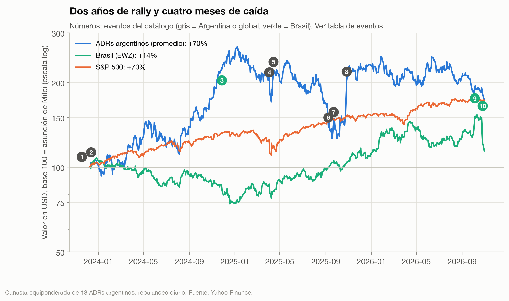
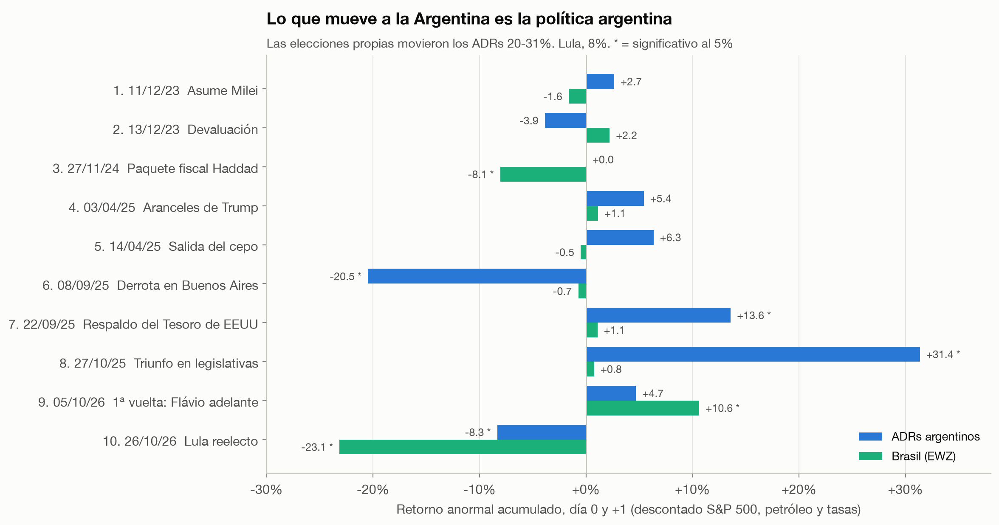
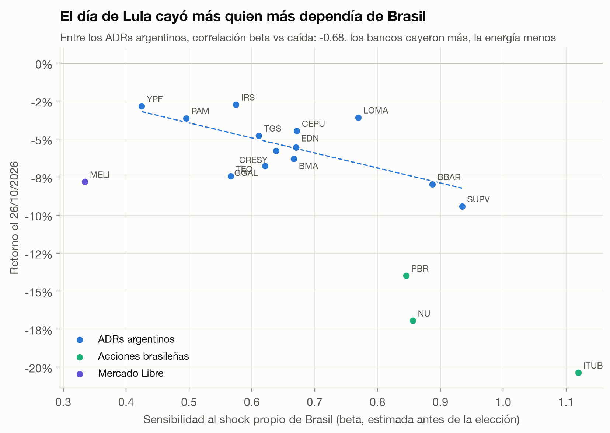
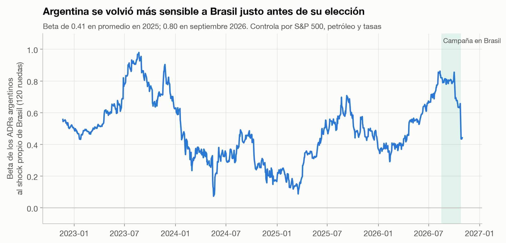
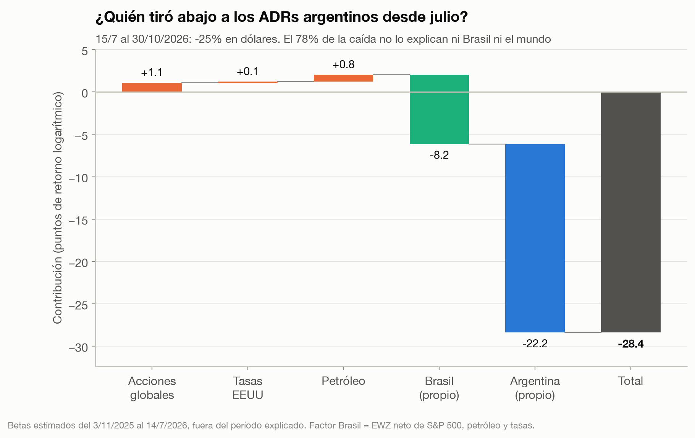

# ¿Argentina, Brasil o el mundo?

**Qué explica la caída de los activos argentinos en 2026: un *event study* del gobierno de Milei y del contagio de la reelección de Lula.**



## Resumen

- **El contexto.** Desde el mínimo del riesgo país a mediados de julio de 2026, los ADRs argentinos cayeron **25% en dólares**, mientras el S&P 500 quedó plano. El riesgo país superó los 700 puntos en octubre y siguió subiendo tras la reelección de Lula en Brasil (25/10). El gobierno atribuyó la suba al contexto internacional y a la incertidumbre electoral.
- **La respuesta: 4 de cada 5 puntos de la caída son argentinos.** Con un modelo de factores estimado *antes* de la caída, el mundo (acciones, petróleo, tasas) explica **+2 puntos**, es decir, empujó a favor. Brasil explica **−8**. Quedan **−22 puntos** (78%) que ni Brasil ni el mundo explican. El resultado se sostiene con cuatro ventanas de estimación distintas (77% a 96%).
- **Lo que mueve a la Argentina es la política argentina.** En dos días, la derrota en Buenos Aires (sep. 2025) restó 20% a los ADRs, el respaldo del Tesoro de EEUU sumó 14% y el triunfo en las legislativas, 31%. La reelección de Lula, el shock regional más grande de la muestra, restó **8%**.
- **El contagio de Lula fue selectivo.** El 26/10 cayeron más los ADRs con mayor sensibilidad a Brasil (bancos −8% a −9%) y menos la energía (YPF −3%). Aun así, los argentinos cayeron solo el **37%** de lo que predecía su comovimiento habitual con Brasil. Las acciones brasileñas cayeron el 89%: el mercado leyó el shock como fiscal-brasileño, no regional.

## 1. Preguntas e hipótesis

1. **¿Qué parte de la caída desde julio de 2026 es Argentina, Brasil o el mundo?** H0: los factores externos explican la mayor parte. Se rechaza si el componente propio de Argentina supera la mitad de la caída en todas las ventanas de estimación.
2. **¿Los eventos políticos argentinos mueven más a los ADRs que los brasileños?** Se mide con retornos anormales y su estadístico t.
3. **¿El contagio de Lula pasó por la exposición a Brasil?** H0: no hay relación entre la sensibilidad previa a Brasil y la caída del 26/10. Se rechaza si la correlación entre ambas es claramente negativa.

## 2. Datos

| | |
|---|---|
| Argentina | Canasta equiponderada de 13 ADRs: GGAL, BMA, BBAR, SUPV, YPF, PAM, TGS, CEPU, EDN, TEO, CRESY, LOMA, IRS |
| Brasil | EWZ (ETF MSCI Brasil); ITUB, NU, PBR para el corte transversal |
| Mundo | S&P 500 (SPY), petróleo Brent (BZ=F), tasa del Tesoro de EEUU a 10 años (^TNX) |
| Aparte | Mercado Libre (MELI): es argentina pero con más negocio en Brasil |
| Fuente | Yahoo Finance, precios ajustados, congelados a CSV en `data/` |
| Período | junio 2022 a 30/10/2026, ruedas de Wall Street |

Por qué ADRs: cotizan en dólares en un mercado líquido, así que miden lo que ve un inversor internacional, sin la distorsión del tipo de cambio local. Por qué EWZ y no el Ibovespa: cotiza en las mismas ruedas y la misma moneda que los ADRs.

## 3. Método

**Retorno anormal (eventos).** Para cada evento se estima un modelo de factores con 250 ruedas que terminan 10 ruedas antes del evento, para que encuestas y rumores no contaminen lo que se considera "normal". El retorno anormal es lo que pasó menos lo que el modelo predecía dada la jornada del S&P 500, el petróleo y las tasas. Se acumula en el día 0 y el +1, y el estadístico t sale de la volatilidad de los residuos (Brown & Warner, 1985).

**Factor Brasil.** Es el retorno de EWZ que no explican los factores globales: el shock *propio* de Brasil. Sin esa limpieza, una caída global se contaría dos veces.

**Atribución de la caída.** Los betas de los ADRs a los cuatro factores se estiman del 3/11/2025 (después de las legislativas) al 14/7/2026, **fuera** del período a explicar. Cada factor aporta su beta por el retorno que tuvo entre el 15/7 y el 30/10. Lo que queda es el componente argentino. Estimar los betas dentro del mismo período haría que el residuo diera cero por construcción.

**Catálogo de eventos.** Solo hechos con fecha cierta, cada uno con su fuente ([`estudio/eventos.py`](estudio/eventos.py)). Las elecciones de domingo tienen el día 0 el lunes. Los procesos graduales, como la suba del riesgo país o la guerra en el Golfo, entran como factores y no como eventos.

## 4. Resultados

### Los eventos



| Evento | ADRs argentinos | t | Brasil (EWZ) | t |
|---|---:|---:|---:|---:|
| Asume Milei (11/12/23) | +2,7% | 0,7 | −1,6% | −0,7 |
| Devaluación (13/12/23) | −3,9% | −1,0 | +2,2% | 1,0 |
| Paquete fiscal Haddad (27/11/24) | +0,0% | 0,0 | **−8,1%** | −5,0 |
| Aranceles de Trump (3/4/25) | +5,4% | 1,5 | +1,1% | 0,6 |
| Salida del cepo (14/4/25) | +6,3% | 1,8 | −0,5% | −0,3 |
| Derrota en Buenos Aires (8/9/25) | **−20,5%** | −5,7 | −0,7% | −0,4 |
| Respaldo del Tesoro de EEUU (22/9/25) | **+13,6%** | 3,8 | +1,1% | 0,6 |
| Triunfo en legislativas (27/10/25) | **+31,4%** | 7,1 | +0,8% | 0,4 |
| 1ª vuelta en Brasil: Flávio adelante (5/10/26) | +4,7% | 1,1 | **+10,6%** | 5,3 |
| Lula reelecto (26/10/26) | **−8,3%** | −2,0 | **−23,1%** | −10,3 |

En negrita, significativo al 5%. Los shocks argentinos no movieron a Brasil, y los brasileños movieron a la Argentina mucho menos que a Brasil: el traspaso fue de alrededor de 0,4 (4,7/10,6 y 8,3/23,1). La reelección de Lula fue, en dos días, el peor shock propio de Brasil de la muestra.

### La reelección de Lula, acción por acción



Entre los ADRs argentinos, la correlación entre la sensibilidad previa a Brasil y la caída del 26/10 es **−0,68**: el contagio pasó por la exposición a Brasil. Los bancos (SUPV, BBAR) cayeron más; la energía (YPF, PAM) menos, porque su negocio depende de Vaca Muerta y del petróleo, no de Brasil.

El dato más interesante es la magnitud. Con su beta habitual, un ADR argentino promedio "debería" haber caído unas 2,7 veces más de lo que cayó. Las acciones brasileñas sí cayeron casi lo que predecía su beta. Una lectura: el comovimiento normal entre Argentina y Brasil refleja el humor general hacia la región, mientras que este shock fue específico del frente fiscal brasileño. Mercado Libre fue la excepción: cayó más de lo que predecía su beta a Brasil, el mercado donde está la mayor parte de su negocio.

### Una relación que se estrechó y se aflojó



La sensibilidad de los ADRs al shock propio de Brasil se duplicó: de 0,41 en promedio en 2025 a 0,80 en septiembre de 2026, en plena campaña brasileña. Con la caída de octubre, que fue sobre todo argentina, volvió a 0,44. No es inédito: antes de la elección argentina de 2023 también llegó a 1,0. **En años electorales, Argentina y Brasil se mueven más juntos.**

### ¿Quién tiró abajo a los ADRs desde julio?



| Ventana de estimación de betas | Mundo | Brasil | Argentina | Total |
|---|---:|---:|---:|---:|
| **3/11/2025 a 14/7/2026 (base)** | +2,0 | −8,2 | **−22,2** | −28,4 |
| 2/1/2024 a 14/7/2026 | +2,5 | −3,6 | −27,3 | −28,4 |
| 15/7/2025 a 14/7/2026 | +3,7 | −7,6 | −24,4 | −28,4 |
| 2/1/2026 a 14/7/2026 | +2,2 | −8,6 | −21,9 | −28,4 |

Puntos de retorno logarítmico; "Mundo" suma S&P 500, petróleo y tasas. Detalle por factor en [`estudio/results.md`](estudio/results.md).

En ninguna ventana el contexto global explica la caída: el S&P 500 subió y los ADRs argentinos casi no reaccionan al petróleo (beta 0,03), aun con un Brent que subió más de 35% en el período. Brasil restó entre 4 y 9 puntos. El resto, **entre 22 y 27 puntos de 28**, es argentino.

**Qué significa "argentino".** El modelo no dice qué fue: solo que no fue el mundo ni Brasil. Lo que sí coincide en el tiempo, según la prensa: la inflación que dejó de bajar (cerca de 2% mensual desde junio), la actividad que se enfrió (JPMorgan habla de recesión técnica), la desaprobación del gobierno cerca del 60% y encuestas para 2027 con Milei sin superar el 40%. Son candidatos razonables, pero este estudio no los testea.

## 5. Limitaciones

- **Una canasta equiponderada no es "Argentina".** Excluye bonos soberanos, el instrumento del riesgo país, porque Yahoo no tiene su historia. Los bonos podrían tener otra sensibilidad a Brasil.
- **El factor Brasil se estima con la misma regresión global** que el resto. Si los factores globales están mal especificados, parte del residuo de Brasil o de Argentina sería en realidad global.
- **R² de 0,34.** El modelo explica un tercio de la variación diaria de los ADRs. Es normal en un mercado dominado por noticias locales, y es justamente el punto del estudio, pero hace imprecisa la atribución factor por factor.
- **Un día de desfase en el tipo de cambio de Yahoo.** El real aparece moviéndose el 27/10, no el 26. Por eso los eventos usan ventanas de dos días y el estudio no usa el tipo de cambio como factor.
- **Fechas del catálogo.** El paquete Haddad se fecha el 27/11/2024, el día de la filtración, porque el 28 Wall Street cerró por Thanksgiving.
- **Pocos eventos brasileños** (3). La comparación Argentina vs Brasil es descriptiva, no un test formal entre grupos.
- **Bug encontrado y corregido.** En la primera versión, el retorno del día posterior a cada feriado de EEUU se perdía al combinar activos con calendarios distintos. Eso subestimaba, por ejemplo, la caída de Brasil con el paquete Haddad (−4,6% contra −8,1% real). Las conclusiones no cambiaron.

## 6. Cómo reproducir

```bash
uv sync
uv run pytest
uv run python estudio/run.py
```

```
src/quantkit/events.py   modelo de factores, retorno anormal, atribución, beta rodante
src/quantkit/data.py     descarga y caché de precios
estudio/eventos.py       catálogo de eventos con fecha y fuente
estudio/run.py           análisis, figuras y tablas
tests/test_events.py     cada herramienta recupera un efecto plantado en datos sintéticos
```

## Fuentes de contexto

- Resultados en Brasil: [Wikipedia, elecciones generales de Brasil de 2026](https://es.wikipedia.org/wiki/Elecciones_generales_de_Brasil_de_2026); [Chequeado, primera vuelta](https://chequeado.com/el-explicador/elecciones-en-brasil-2026-las-claves-de-los-resultados-de-la-primera-vuelta-de-cara-al-balotaje-entre-flavio-bolsonaro-y-lula/).
- Reacción del mercado brasileño: [InfoMoney, 26/10/2026](https://www.infomoney.com.br/mercados/ibovespa-hoje-bolsa-de-valores-ao-vivo-26102026/); [Gazeta do Povo](https://www.gazetadopovo.com.br/economia/apos-reeleicao-de-lula-ibovespa-tem-pior-semana-desde-a-pandemia-e-dolar-dispara/).
- Contagio en Argentina: [Infobae, la empresa más golpeada](https://www.infobae.com/economia/2026/10/26/cual-es-la-empresa-argentina-mas-golpeada-por-la-victoria-de-lula-en-brasil/); [Río Negro, riesgo país](https://www.rionegro.com.ar/economia/el-riesgo-pais-de-argentina-toco-los-745-puntos-por-el-impacto-de-la-reeleccion-de-lula-en-brasil-4772932/).
- Riesgo país y explicación oficial: [Infobae, 19/10/2026](https://www.infobae.com/politica/2026/10/19/la-incertidumbre-global-y-el-escenario-electoral-como-explica-el-gobierno-la-suba-del-riesgo-pais/); [Infobae, encuesta de desaprobación](https://www.infobae.com/politica/2026/10/19/aciertos-y-deudas-del-gobierno-de-milei-la-desaprobacion-llega-al-60-mientras-crece-la-incertidumbre-electoral-segun-una-encuesta/); [MisionesOnline, 22/10/2026](https://misionesonline.net/2026/10/22/javier-milei-admitio-la-desaceleracion-economica-y-vinculo-el-aumento-del-riesgo-pais-con-la-incertidumbre-politica-y-el-contexto-global/).
- Petróleo: [Infobae/EFE, Brent a 110 dólares](https://www.infobae.com/america/agencias/2026/10/21/el-petroleo-brent-sube-mas-del-1-y-alcanza-los-110-dolares-pendiente-de-ee-uu-e-iran/).
- Método: Brown & Warner (1985), *Using daily stock returns: the case of event studies*; MacKinlay (1997), *Event studies in economics and finance*.
